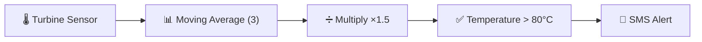

# NexusFlow
### Visual IoT Telemetry & Rule Engine

NexusFlow is a visual, no-code IoT telemetry processing platform that enables users to create monitoring and automation workflows using a drag-and-drop interface instead of writing code. Users can visually connect nodes such as sensors, filters, mathematical operations, conditions, and actions to build real-time processing pipelines for industrial telemetry data. 

---

## 🚀 Project Overview

Modern industrial environments generate large volumes of sensor data from turbines, motors, boilers, cooling systems, and other equipment. Traditional monitoring solutions often require business rules to be hardcoded by developers, making changes slow and costly.

NexusFlow solves this problem by allowing users to:

- Create workflows visually through drag-and-drop nodes.
- Store and query telemetry in MongoDB Time-Series Collections.
- Validate workflow structures using DAG validation.
- Compile visual workflows into executable RxJS stream pipelines.
- Simulate workflow execution before deployment.
- Trigger actions such as alerts when conditions are met.
- Save, load, and manage workflows from the cloud. 

---

## ✨ Key Features

### Week 1
- Telemetry ingestion APIs
- MongoDB Time-Series storage
- Device registry and tracking
- Historical telemetry querying
- Telemetry simulator
- Visual workflow canvas foundation 

### Week 2
- Custom workflow nodes
- Graph serialization
- DAG validation using Kahn's Algorithm
- Cycle detection
- RxJS stream pipeline compilation
- Interactive workflow simulation
- Workflow persistence and deployment
- Workflow execution monitoring 

---

# 🏗️ System Architecture

```text
┌──────────────────────────────────────┐
│               USER                   │
└──────────────────┬───────────────────┘
                   │
                   ▼
┌──────────────────────────────────────┐
│            React Frontend            │
│                                      │
│  • Workflow Builder (React Flow)     │
│  • Telemetry Explorer                │
│  • Node Inspector                    │
│  • Simulation Results                │
│  • Workflow Management               │
└──────────────────┬───────────────────┘
                   │ REST API
                   ▼
┌──────────────────────────────────────┐
│         Node.js + Express API        │
│                                      │
│ • Telemetry Controller               │
│ • Workflow Controller                │
│ • Device Controller                  │
└───────────────┬───────────────┬──────┘
                │               │
                │               │
                ▼               ▼

┌───────────────────────┐   ┌─────────────────────┐
│   MongoDB Time-Series │   │      Rule Engine    │
│                       │   │                     │
│ • Telemetry Storage   │   │ • Graph Validation  │
│ • Historical Queries  │   │ • DAG Detection     │
│ • Batch Ingestion     │   │ • RxJS Compilation  │
└───────────────────────┘   │ • Stream Execution  │
                            └──────────┬──────────┘
                                       │
                                       ▼
                            ┌─────────────────────┐
                            │ Alert Service       │
                            │                     │
                            │ • SMS Alert         │
                            │ • Webhook Alert     │
                            │ • Incident Log      │
                            └─────────────────────┘
```

### Technology Stack

#### Frontend
- React
- Vite
- React Flow
- Axios
- Lucide React 

#### Backend
- Node.js
- Express.js
- RxJS
- Mongoose 

#### Database
- MongoDB Time-Series Collections 

---

# 🔄 End-to-End Process Flow

```text
┌───────────────┐
│ User Creates  │
│ Workflow      │
└───────┬───────┘
        │
        ▼
┌───────────────────────────┐
│ Drag & Drop Nodes         │
│ Sensor → Filter → Action  │
└───────────┬───────────────┘
            │
            ▼
┌───────────────────────────┐
│ Serialize Workflow        │
│ To JSON                   │
└───────────┬───────────────┘
            │
            ▼
┌───────────────────────────┐
│ Backend Validation        │
│ - Validate Nodes          │
│ - Validate Connections    │
│ - Detect Cycles           │
└───────────┬───────────────┘
            │
            ▼
┌───────────────────────────┐
│ Graph Compilation         │
│ JSON → RxJS Pipeline      │
└───────────┬───────────────┘
            │
            ▼
┌───────────────────────────┐
│ Workflow Deployment       │
└───────────┬───────────────┘
            │
            ▼
┌───────────────────────────┐
│ Sensor Readings Arrive    │
│ Through Ingestion API     │
└───────────┬───────────────┘
            │
     ┌──────┴──────┐
     │             │
     ▼             ▼
┌───────────┐ ┌─────────────┐
│ Store in  │ │ Process Via │
│ MongoDB   │ │ RxJS Engine │
└─────┬─────┘ └──────┬──────┘
      │              │
      │              ▼
      │      ┌─────────────┐
      │      │ Conditions  │
      │      │ Evaluated   │
      │      └──────┬──────┘
      │             │
      │     True?
      │             │
      │             ▼
      │      ┌─────────────┐
      │      │ Trigger     │
      │      │ Alert       │
      │      └─────────────┘
      │
      ▼
┌─────────────┐
│ Historical  │
│ Queries     │
└─────────────┘
```

## ⚙️ Example Workflow Execution



---


# 🧩 Supported Workflow Nodes

| Category | Purpose |
|-----------|---------|
| Sensor | Select telemetry source |
| Filter | Moving average processing |
| Math | Multiply, add, subtract, divide |
| Condition | Evaluate thresholds |
| Action | SMS, Webhook, Incident Log | 


---

# 📁 Project Structure

```text
NexusFlow/
│
├── frontend/
│   ├── src/
│   │   ├── components/
│   │   ├── pages/
│   │   ├── services/
│   │   ├── App.jsx
│   │   └── main.jsx
│   └── vite.config.js
│
├── backend/
│   ├── config/
│   ├── controllers/
│   ├── models/
│   ├── routes/
│   ├── services/
│   ├── simulator/
│   ├── scripts/
│   └── server.js
│
└── README.md
```


---

# 🏃 Quick Start Guide

### 1. Prerequisites
- **Node.js** (v18+ or v22+)
- **MongoDB** (v6.0+ or v8.0+) running locally on port 27017

### 2. Backend Setup & Automated Verification
```powershell
cd backend
npm install
npm run test:compiler    # Runs Week 2 Logic Engine & RxJS Compiler test suite (17 checks)
npm run test:storage     # Runs Week 1 Time-Series storage verification
npm run benchmark        # Runs Mid-Project Review 5,000 writes/sec benchmark
npm run dev              # Starts backend on http://localhost:5000
```

### 3. Frontend Setup & Run
In a new terminal:
```powershell
cd frontend
npm install
npm run dev              # Starts frontend on http://localhost:3000
```

### 4. Run Mock Sensor Simulator
In a separate terminal:
```powershell
cd backend
npm run simulate         # Streams simulated sensor readings into the ingestion API
```

---

## 📖 Subproject Documentation & Testing Guides
- [Backend Documentation & Testing Guide](backend\README.md)
- [Frontend Documentation & Testing Guide](frontend\README.md)
